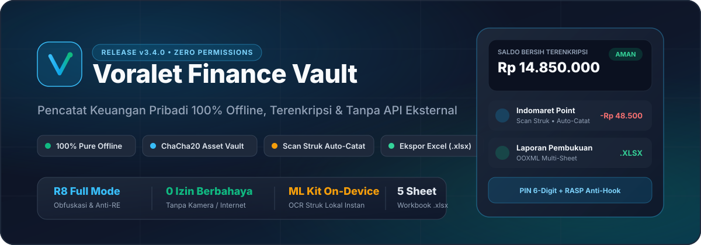

<div align="center">

  

  <br/><br/>

  <h1>Voralet — Personal Finance Vault</h1>
  <p>
    <strong>Aplikasi Pencatat Keuangan Pribadi, Buku Kas, Manajemen Dompet, Scan Struk Offline &amp; Pembukuan Excel (<code>.xlsx</code>)</strong><br/>
    <em>100% Pure Offline • Zero Cloud AI • Zero API Keys • Zero Tracking Permissions • Anti-Reverse-Engineering</em>
  </p>

  <p>
    <a href="https://github.com/Bagas240/Voralet-pencatat-keuangan-pribadi-/releases">
      
    </a>
    
    
    
    
  </p>

  <p>
    <a href="#-download--instalasi-apk">Download APK</a> •
    <a href="#-fitur-unggulan">Fitur Unggulan</a> •
    <a href="#-arsitektur-keamanan--anti-reverse-engineering">Keamanan &amp; Anti-RE</a> •
    <a href="#-ringan--hemat-baterai">Optimasi Baterai</a> •
    <a href="#-panduan-sertifikat-signing--lisensi-github">Sertifikat &amp; Lisensi</a>
  </p>

</div>

---

## Ringkasan Eksekutif

**Voralet** adalah aplikasi pencatat keuangan pribadi Android yang dibangun dengan filosofi **Privacy-First** dan **Zero Network Dependency**. Seluruh data transaksi, saldo kantong/dompet, catatan hutang-piutang, target tabungan, hingga pemindaian struk belanja diproses **sepenuhnya di dalam perangkat Anda** tanpa server pihak ketiga, tanpa API key eksternal, dan tanpa ketergantungan layanan AI cloud.

Dirancang agar tetap ringan, responsif 60/90/120Hz, serta hemat baterai, Voralet v3.4.0 menghadirkan pengerasan keamanan tingkat biner (*ChaCha20-encrypted asset vault*, *R8 Full Mode*, dan *RASP Anti-Hook*) sekaligus fitur produktivitas nyata seperti **Ekspor Workbook Excel (`.xlsx`) 5 Sheet Otomatis** dan **Pemindai Struk Belanja Offline (ML Kit) dengan Auto-Catat**.

---

## Preview Fitur & Arsitektur

<p align="center">
  
</p>

---

## Fitur Unggulan

| Kategori | Kemampuan Utama |
| :--- | :--- |
| **Brankas PIN & Privasi** | Kunci aplikasi dengan **6-digit PIN lokal** + *Privacy Mode* (sembunyikan saldo dengan satu ketukan) + `FLAG_SECURE` mencegah tangkapan layar/perekaman oleh aplikasi lain. |
| **Multi Dompet & Akun** | Pisahkan pencatatan rekening Bank, E-Wallet, dan Tunai dengan kalkulasi saldo real-time otomatis untuk Pemasukan, Pengeluaran, dan Transfer antar akun. |
| **Scan Struk Offline (Auto-Catat)** | Pindai struk belanja lewat kamera atau galeri menggunakan **ML Kit Text Recognition** (100% di perangkat, tanpa izin `CAMERA` maupun kuota internet). Dengan mode **Auto-Catat**, total harga, merchant, item belanja, dan kategori langsung tercatat otomatis menjadi transaksi! |
| **Ekspor Excel Otomatis (`.xlsx`)** | Generator **OOXML `.xlsx` Multi-Sheet** murni Kotlin tanpa dependensi berat. Menghasilkan 5 sheet terformat rapi (**Ringkasan Keuangan, Mutasi Transaksi, Hutang & Piutang, Tabungan Impian, Daftar Dompet**) lengkap dengan format mata uang Rupiah, *freeze header*, dan simpan langsung via Android Storage Access Framework (SAF) atau bagikan. |
| **Laporan PDF & Backup Terenkripsi** | Ekspor ringkasan kas bulanan ke PDF dan cadangkan/pulihkan database penuh dengan integritas tanda tangan HMAC-SHA256. |
| **Tabungan Impian, Hutang & Streak** | Pantau progres target dana impian, catat hutang/piutang beserta cicilan, kelola streak kedisiplinan finansial, serta Widget Home Screen ringan (*Streak* & *Pet Companion*). |

---

## Arsitektur Keamanan & Anti-Reverse-Engineering

Voralet menerapkan prinsip **Defense in Depth** untuk melindungi kode sumber dan data keuangan dari upaya dekompilasi, ekstraksi aset, maupun injeksi runtime:

1. **Encrypted Offline Asset Vault (`voralet_core.bin`)**
   - Bundel antarmuka web dikompresi (`zlib`) dan dienkripsi saat *build time* menggunakan **ChaCha20** dengan verifikasi **Encrypt-then-MAC (`HMAC-SHA256`)** ke dalam berkas biner `voralet_core.bin`.
   - Tidak ada berkas `index.html` atau kode JS mentah di dalam folder `assets/` APK. Dekripsi dilakukan murni di **RAM (in-memory stream)** saat runtime melalui `AssetVaultDecryptor`.
2. **R8 Full Mode & Obfuskasi Ketat (`proguard-rules.pro`)**
   - Mengaktifkan `android.enableR8.fullMode=true`, `isMinifyEnabled = true`, dan `isShrinkResources = true`.
   - Menghapus atribut `SourceFile` dan `LineNumberTable`, meratakan hierarki paket (`-repackageclasses`), menghapus `android.util.Log` serta pesan pengecekan `kotlin.jvm.internal.Intrinsics`, dan membatasi *keep rules* hanya pada metode `@JavascriptInterface`.
3. **Runtime Application Self-Protection (`AppSecurityGuard`)**
   - Mendeteksi *debugger* (`Debug.isDebuggerConnected`, `/proc/self/status` `TracerPid`), kerangka injeksi (*Frida*, *Xposed*, *LSPosed*, *Zygisk* via `/proc/self/maps` dan class probe), perangkat *rooted*, serta memverifikasi integritas sertifikat penandatanganan APK (*anti-repackaging*).
4. **Hardened Offline WebView & Zero Permissions Policy**
   - `AndroidManifest.xml` **tidak mendeklarasikan satu pun izin sensitif** (`0` izin `INTERNET`, `CAMERA`, `READ_EXTERNAL_STORAGE`, `WRITE_EXTERNAL_STORAGE`, `LOCATION`, `RECORD_AUDIO`).
   - WebView memaksa `setWebContentsDebuggingEnabled(false)`, `blockNetworkLoads = true`, `allowFileAccess = false`, `allowContentAccess = false`, pemblokiran navigasi eksternal, serta CSP ketat bebas URL eksternal.
   - `android:allowBackup="false"` dan `android:usesCleartextTraffic="false"` mencegah ekstraksi data lewat *ADB backup*.

---

## Ringan & Hemat Baterai

Animasi antarmuka yang halus tidak harus mengorbankan konsumsi daya:

- **Pre-Compiled ECMAScript (`0 ms` Babel Overhead)**: Proses transpilasi JSX dijalankan saat *build* di PC/CI; file `babel.min.js` (~2.8 MB) dihapus sepenuhnya dari APK.
- **Background Animation Freezing**: Saat pengguna berpindah aplikasi atau layar mati (`onPause` / `document.hidden`), seluruh animasi CSS (`voralet-paused`) dan loop `requestAnimationFrame` (`AnimatedCurrency`) langsung dihentikan seketika agar penggunaan CPU/GPU turun ke `0%`.
- **GPU-Composited Keyframes**: Efek nyala streak menggunakan `transform` dan `opacity` (menggantikan `filter: drop-shadow()` per-frame yang berat bagi GPU ponsel entry-level), serta mendukung mode *Reduced Motion*.
- **Zero Background Services**: Tidak ada `WorkManager` periodik, *polling*, maupun *wakelock* yang menguras baterai di latar belakang.

---

## Download & Instalasi APK

### Cara Mengunduh Rilis Resmi

1. Buka halaman **[GitHub Releases](https://github.com/Bagas240/Voralet-pencatat-keuangan-pribadi-/releases)**.
2. Pilih rilis versi terbaru (**`v3.4.0`** atau lebih baru) dan unduh berkas **`Voralet-v3.4.0.apk`** pada bagian **Assets**.
3. Jika menginstal dari luar Play Store, izinkan *"Instal aplikasi tidak dikenal"* untuk browser/file manager Anda di Pengaturan Android.
4. Buka Voralet, buat **6-digit PIN lokal**, dan mulai kelola keuangan Anda secara offline.

### Verifikasi Keaslian Berkas (SHA-256 Checksum)

Untuk memastikan APK belum dimodifikasi pihak ketiga, cocokkan nilai hash SHA-256 berkas unduhan Anda dengan nilai yang dipublikasikan pada catatan rilis:

```bash
# Linux / macOS / Termux
sha256sum Voralet-v3.4.0.apk

# Windows (PowerShell)
Get-FileHash .\Voralet-v3.4.0.apk -Algorithm SHA256
```

---

## Teknologi yang Digunakan

| Lapisan | Teknologi |
| :--- | :--- |
| **Android Native** | Kotlin, Jetpack Compose (Material 3), AppWidget, Android System WebView, FileProvider & SAF |
| **Security & Hardening** | ChaCha20 + HMAC-SHA256 RAM Asset Vault, R8 Full Mode Obfuscation, RASP (`AppSecurityGuard`), `FLAG_SECURE` |
| **Offline OCR** | Google ML Kit Text Recognition (`com.google.mlkit:text-recognition:16.0.1` — *bundled on-device model*) |
| **Spreadsheet Export** | Custom Pure-Kotlin OOXML `.xlsx` Generator (`java.util.zip.ZipOutputStream`, Multi-Sheet) |
| **Frontend UI** | Pre-compiled React 18, Local Tailwind CSS Runtime, Inline SVG Icons, Sandboxed LocalStorage Vault |
| **Automated Testing** | JUnit4, Robolectric SDK 36, Python Integrity Verifier (`verify_master_security.py`) |

---

## Spesifikasi Perangkat

<details>
<summary><strong>Lihat Spesifikasi Minimum & Rekomendasi</strong></summary>

### Spesifikasi Minimum
- **OS**: Android 7.0 (Nougat / API 24) ke atas
- **WebView**: Android System WebView v80+
- **RAM**: 2 GB
- **Penyimpanan Kosong**: ± 35 MB
- **Layar**: HD (720 × 1280 px)

### Spesifikasi Rekomendasi
- **OS**: Android 11 – 16 (API 30 – 36)
- **RAM**: 3 GB atau lebih
- **Penyimpanan Kosong**: 100 MB
- **Prosesor**: Octa-core modern (Snapdragon / Dimensity / Helio / Exynos)
- **Layar**: FHD+ (1080 × 2400 px) @ 60Hz / 90Hz / 120Hz

</details>

---

## Membangun dari Kode Sumber (Developer Guide)

### Prasyarat
- **JDK 17**
- **Android SDK (Compile SDK 36, Min SDK 24)**
- **Python 3.10+** dan **Node.js 18+** (hanya untuk kompilasi aset saat build)

### Langkah Build & Verifikasi Lokal

```bash
# 1. Jalankan audit integritas keamanan & kebersihan offline
python3 verify_master_security.py

# 2. Pre-compile JSX & enkripsi aset web ke app/src/main/assets/voralet_core.bin
python3 build_index.py

# 3. Jalankan seluruh Unit Test & Robolectric Test (dekripsi vault, Excel OOXML, RASP)
gradle :app:testDebugUnitTest

# 4. Bangun APK Debug atau Release (signed)
gradle assembleDebug
```

> **Catatan CI/CD**: Alur GitHub Actions (`.github/workflows/build-apk.yml`) secara otomatis menjalankan audit keamanan, pre-kompilasi vault terenkripsi, pengujian unit/Robolectric, hingga menghasilkan artefak APK rilis pada setiap tag `v*`.

---

## Panduan Sertifikat Signing & Lisensi GitHub

### 1. Rekomendasi Sertifikat Signing Android (Keystore)
- **Jenis Keystore**: Gunakan **Upload Keystore `.jks` / PKCS12** dengan algoritma **RSA 4096-bit** (atau minimal RSA 2048-bit) dan masa berlaku **25+ tahun (`-validity 10000`)**.
- **Pemisahan Key (Google Play App Signing)**: Jika merilis ke Google Play Store, aktifkan *Play App Signing* sehingga *App Signing Key* disimpan aman di Google dan Anda hanya memegang *Upload Key* untuk mengunggah pembaruan.
- **Penyimpanan Aman CI/CD**: Jangan pernah mengunggah berkas `.jks` atau kata sandi keystore ke repositori Git. Simpan sebagai **GitHub Repository Secrets** (`KEYSTORE_BASE64`, `STORE_PASSWORD`, `KEY_PASSWORD`) untuk dipakai oleh `signingConfigs.release`.
- **Publikasi Fingerprint**: Cantumkan **SHA-256 Certificate Fingerprint** resmi di halaman GitHub Releases agar pengguna dapat memverifikasi keaslian APK.

### 2. Rekomendasi Lisensi GitHub
- **Proprietary / All Rights Reserved** *(Direkomendasikan jika prioritas utama adalah mencegah pihak lain memodifikasi, menyalin ulang, atau merilis ulang aplikasi komersial/pribadi Anda dari repo atau hasil dekompilasi).*
- **Apache License 2.0** *(Direkomendasikan jika ingin tetap Open-Source secara profesional: mengizinkan publik mempelajari/berkontribusi sambil melindungi hak paten kontributor dan melarang penyalahgunaan merek "Voralet").*
- **GNU GPLv3** *(Direkomendasikan jika ingin memastikan siapa pun yang membuat modifikasi wajib membuka kembali kode sumber turunannya).*

---

## Pengembang & Kontributor

<div align="center">

Dikembangkan dan dipelihara dengan fokus pada privasi finansial oleh **[@Bagas240](https://github.com/Bagas240)**.

*Seluruh saran perbaikan bug, peningkatan keamanan, maupun pelaporan celah dapat disampaikan melalui tab [Issues](https://github.com/Bagas240/Voralet-pencatat-keuangan-pribadi-/issues).*

</div>

---

## Lisensi

Hak Cipta © 2026 **Bagas240 — Voralet**. Seluruh hak dilindungi (*All Rights Reserved* — sesuaikan berkas `LICENSE` pada repositori sesuai kebijakan distribusi yang dipilih).
